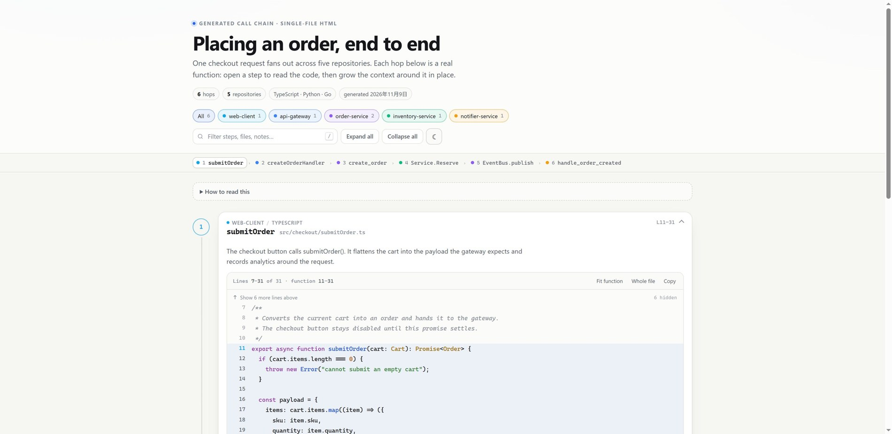
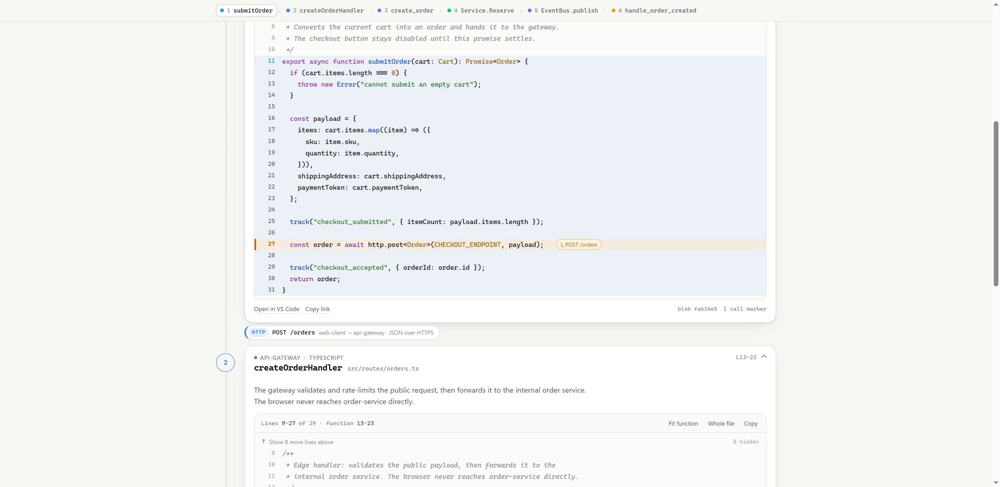
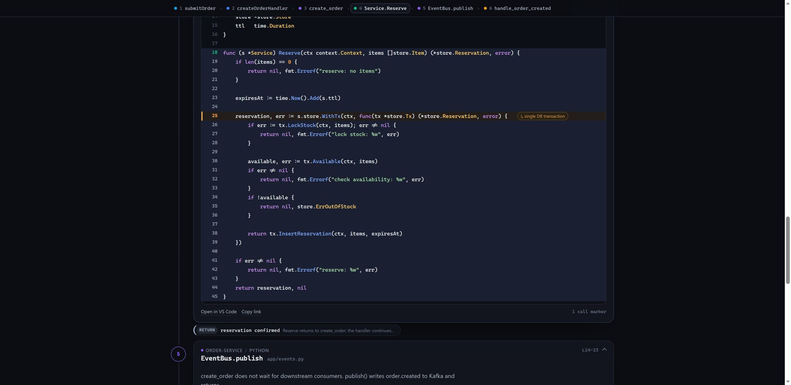

# Call-chain explorer — readable cross-repo code walkthroughs

A small generator plus a zero-dependency HTML viewer for reading a call chain that crosses
several repositories. Markdown is good for prose but poor for code: this artifact puts the
actual function next to every hop, lets you grow the context around it in place, and still
ships as **one offline HTML file** you can attach to a ticket or a review.

This repository is both a **worked example** and a **template**: the demo below is generated
from `chain.spec.json`, and `new_chain.py` scaffolds a new standalone project for your own
chain (generator + viewer + starter spec + README).

The demo follows one checkout request across five small repositories (TypeScript, Python and
Go): browser → API gateway → order service → inventory service → event bus → notifier.



## Try it

Open [`dist/callchain.html`](dist/callchain.html) in a browser. It needs no server and no
network — CSS, JS, code snippets and data are all inlined.



What you can do in the viewer:

- **Read the chain top to bottom.** Repo colour, file, symbol, line range and a
  protocol-coloured hop pill (HTTP / gRPC / event / return) sit between steps.
- **Open a step** to show its code with the function highlighted.
- **Grow the context** with `↑ Show N more lines` / `↓ Show N more lines`; each click adds
  10 lines. `Fit function` returns to the default window, `Whole file` shows everything
  embedded at build time.
- **Jump at the call site.** The orange line marks where the next hop starts; the
  `↳ …` tag jumps to that step (including non-linear branches).
- **Filter** by repository or search file/symbol/note text; the minimap tracks your position.
- **Check provenance.** `blob 4f2a1ec` is the source file's SHA-256 at build time; each step
  also links to `vscode://file/...:line` and shows whether an edge is *asserted* by the
  author or verified by an indexer.
- Keyboard: `j`/`k` previous/next, `e` expand, `/` search. Light/dark theme, printable.

The same page with a Go frame and a `RETURN` hop:



## Build it

```bash
cd research/callchain
python build_callchain.py --spec chain.spec.json --out dist/callchain.html
```

Python 3.10+ standard library only. The build extracts the function boundaries, embeds the
code, hashes each file, and writes `dist/callchain.html` (~71 KB for this demo).

## Use it as a template

Scaffold a standalone project for a new chain:

```bash
cd research/callchain
python new_chain.py ../chains/checkout-flow --title "Checkout flow"
```

This creates a new directory containing its own copy of `build_callchain.py`, `viewer/`, a
starter `chain.spec.json`, an empty `repos/` and a README. The scaffold is self-contained:
it does not depend on this repository at runtime.

Seed the scaffold with the five-repo order-flow demo instead of an empty spec:

```bash
python new_chain.py ../chains/order-flow --from-example
```

Then, in the new project, put your checkouts under `repos/`, edit `chain.spec.json`, and run
`python build_callchain.py`. The starter spec intentionally contains `REPLACE_*` values so the
first build fails loudly instead of producing a misleading page.

## Point it at your repos

A chain spec is a small JSON file. Repo roots are resolved relative to the spec file:

```json
{
  "title": "Checkout, end to end",
  "context": 4,
  "repos": {
    "api-gateway": { "root": "../my-repos/api-gateway", "color": "#3b82f6", "ref": "a1b2c3d" },
    "order-service": { "root": "../my-repos/order-service", "color": "#8b5cf6" }
  },
  "steps": [
    {
      "id": "gateway-handler",
      "repo": "api-gateway",
      "file": "src/routes/orders.ts",
      "match": "async function createOrderHandler",
      "symbol": "createOrderHandler",
      "note": "Validates the public request and forwards it internally.",
      "callsites": [
        { "match": "orderClient\\.createOrder", "label": "POST /internal/orders" }
      ],
      "edge": {
        "type": "http",
        "kind": "HTTP",
        "label": "POST /internal/orders",
        "detail": "api-gateway → order-service · internal network"
      }
    }
  ]
}
```

Key properties:

- **`match` is a regex, not a line number.** The generator locates the symbol and derives the
  function body (Python indentation, brace counting for TS/Go/Java/C-like). Line numbers are
  computed, so refactors don't break the spec as often as hand-written ranges do.
- **`callsites[].match`** marks the actual call line(s) inside the body. The first marker on
  a step with an outgoing `edge` jumps to the next step unless the edge type is `return`;
  extra markers can point anywhere with `"to": "<step-id>"`.
- **`edge.type`** is one of `http`, `grpc`, `event`, `return` (colour-coded). Set
  `"verified": true` if the relationship came from an indexer; otherwise it is labelled
  *asserted by the chain author*.
- **`context`** sets the default lines shown around the function per step (or globally).
- **`ref`** is the commit/tag you pinned the snippets to; it is rendered in each step's
  provenance tooltip. Use it.
- **Full files up to 260 lines are embedded**, so `Whole file` works. Larger files embed an
  ±80-line window and the button is disabled; the VS Code link opens the real file.
- **`note`** is the one or two sentences that explain *why* the hop matters.

## How it works

```
chain.spec.json ──► build_callchain.py ──► dist/callchain.html
                     │  find symbol + callsites
                     │  detect function boundaries
                     │  embed snippets + SHA-256
                     └─ inject JSON into viewer template
viewer/template.html + viewer.css + viewer.js
```

The generated page contains a JSON data island, an inline stylesheet, an inline script with
its own small syntax highlighter, and all code lines. No CDN, no fonts, no runtime fetching.
`build_callchain.py` prints the resolved line ranges for every step so you can sanity-check
extraction in CI.

## Repository layout

```
research/callchain/
├── build_callchain.py          # generator (stdlib only)
├── new_chain.py                # scaffold a standalone project from this template
├── template/                   # starter spec + project README for scaffolds
├── chain.spec.json             # demo chain definition
├── demo/repos/                 # five small example repos used by the demo
├── viewer/                     # template.html + viewer.css + viewer.js
├── dist/callchain.html         # generated, self-contained artifact
├── docs/                       # screenshots for this README
├── notes/landscape.md          # prior-art / tooling survey with sources
└── REPORT.md                   # investigation: options, recommendation, risks
```

## Limitations (deliberate for the prototype)

- The chain is **authored**, not discovered. Generating it from OpenTelemetry traces or a
  SCIP/Glean index is the natural next step; the spec is the seam.
- Function boundaries are found with indentation/brace heuristics, not a full parser. They
  work for the demo but can be fooled by exotic syntax; tree-sitter or compiler indexes are
  the production answer.
- Snippets are **snapshots**. The blob hash detects drift but does not fix it; regenerate in
  CI and pin `ref` values.
- The built-in highlighter is intentionally tiny (~150 lines). Production should use
  [Shiki](https://shiki.style/guide/) at build time for TextMate-accurate colours.
- Absolute paths and `vscode://file/...` links are handy locally and should be redacted for
  artifacts that leave the machine.
- One shared history across chains (search across artifacts, permissions) needs a hosted
  variant; see `REPORT.md`.

See [`REPORT.md`](REPORT.md) for the investigation behind these choices and
[`notes/landscape.md`](notes/landscape.md) for the full survey with sources.
