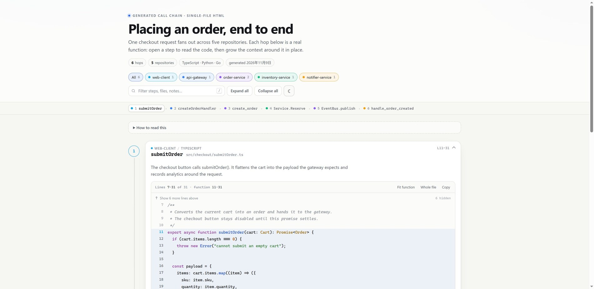

# Investigation: displaying a cross-repo call chain so people can actually read it

**Question.** A call chain crosses several repositories. Markdown is not good for reading code.
HTML seems better — but is it? And can a code block expand to show the surrounding code?

**Short answer.** For a **shared, read-once artifact**, generated single-file HTML is the best
fit — but do not hand-write the HTML. Author a small chain specification and generate the page
from it. HTML wins because it is the only format in the comparison that combines readable code,
in-place context expansion, working links, and offline sharing. It is *not* the best format for
exploration (use an IDE or Sourcegraph) or for maintaining a large catalogue of chains (use a
hosted docs site generated from the same spec).

This folder contains a working prototype of that recommendation: a declarative spec, a
~500-line Python generator, and a zero-dependency viewer. It was verified in a Chromium-based
browser: expansion, context growth, whole-file view, callsite jumps, repository filters, hash
deep links, light/dark themes and the keyboard expand shortcut work; the output has no network
dependencies.



---

## 1. What "good" means for this problem

I evaluated options against seven requirements:

1. **Cross-repo legibility** — a reader can tell which repository and file each hop belongs to
   without opening tabs.
2. **Code, not prose** — the actual source is visible, with line numbers and syntax colour.
3. **Context on demand** — a block can grow upward/downward to reveal more of the file, without
   losing the chain or opening a separate page.
4. **Shareable artifact** — attachable to a ticket/chat, openable offline, no account or server.
5. **Truthful** — provenance is visible; authored edges are distinguishable from verified ones.
6. **Sustainable authoring** — line numbers do not have to be maintained by hand.
7. **Low reader friction** — no install, no clone, no build step at read time.

Plain markdown fails 2 and 3. Diagram tools fail 2 and 3. IDE tools fail 4. Hosted code-search
tools fail 4 and 5 (in the artifact sense). The interesting question is not "HTML vs markdown";
it is **which layer of the stack should be HTML**.

## 2. Landscape findings

A full survey with sources is in [`notes/landscape.md`](notes/landscape.md). The headline:
**no surveyed product ships "cross-repo call chain + inline expandable surrounding code + a
shareable artifact."** The capability is split across three families, each strong on one axis
and weak on the others.

### 2.1 Cross-repo truth: Sourcegraph, SCIP, Glean, Kythe

[Sourcegraph](https://sourcegraph.com/docs) is the strongest commercial answer for reading
across repositories. Its [SCIP](https://github.com/sourcegraph/scip) indexes provide precise,
compiler-grade symbol references across repos. But the product experience is *search and
navigation*: it will show you references and previews, not a curated, linear, readable chain.
It is also hosted/enterprise infrastructure, not an artifact you can drop into a ticket.
[OpenGrok](https://oracle.github.io/opengrok/) does multi-project search but opens whole files.
[Kythe](https://kythe.io/) and Meta's [Glean](https://glean.software/) are credible back ends
for *computing* a call graph (Glean has schema-defined facts and SCIP/LSIF ingestion), but they
ship no reader UI. These are ingredients, not answers.

### 2.2 Inline code context: the IDE peek pattern

[VS Code's call hierarchy](https://code.visualstudio.com/docs/editor/editingevolved#_call-hierarchy)
and [JetBrains'](https://www.jetbrains.com/help/idea/call-hierarchy.html) equivalent are the
interaction people mean by "expand the code around this": a tree of callers/callees plus a peek
widget that shows the definition without leaving the call site. It is excellent, precise, and
fundamentally unshareable — per-workspace, per-user, ephemeral. [CodeTour](https://github.com/microsoft/codetour)
is the closest shareable variant (a JSON tour of file+line steps committed to the repo), but it
assumes one cloned repository, fixed ranges, and an IDE; it is a developer-onboarding tool, not
a review or audit artifact.

### 2.3 Expandable code in documents: solved, but without semantics

[Quarto](https://quarto.org/docs/reference/formats/html.html) documents `code-fold: true` as
literally wrapping code in an HTML `<details>` element; [Expressive Code](https://expressive-code.com/plugins/collapsible-sections/)
collapses arbitrary line ranges (`collapse={1-5, 12-14}`) with a "N collapsed lines" affordance.
[GitHub's diff](https://docs.github.com/en/pull-requests/collaborating-with-pull-requests/reviewing-changes-in-pull-requests) does the same for hidden context. This is the proven pattern: **in-place
range expansion with a visible count**, not a separate "view source" page. What these formats
lack is any model of repositories, files, symbols or call edges; the chain is still hand-written
prose.

### 2.4 The closest prior art is gone

[Sourcetrail](https://github.com/CoatiSoftware/Sourcetrail) — a graph pane plus a source pane
for the selected symbol — was the closest visual synthesis of "topology + readable code." Coati
Software wound down in 2021 and the project is unmaintained. [CodeSee](https://codesee.io/)
appears defunct (the domain failed repeatedly in November 2026; third-party pages discuss it in
the past tense — no official shutdown notice was found, so treat that as *unverified*).
[CodeCharta](https://codecharta.com/) is alive but visualizes metrics, not code.
[AppMap](https://appmap.io/) pivoted to runtime traces. [Structurizr](https://structurizr.com/)/
C4 deliberately stays above code. The AI code-wiki category ([DeepWiki](https://deepwiki.com/),
[Google Code Wiki](https://developers.googleblog.com/en/introducing-code-wiki-accelerating-your-code-understanding/),
Zread) generates prose about a single repository and, as far as I could verify, has no inline
context expansion and no cross-repo chain model.

### 2.5 Markdown's ceiling, concretely

- Mermaid renders boxes and arrows; nodes are labels, never code. Diagram and code are separate
  artifacts that drift independently ([Mermaid docs](https://mermaid.js.org/intro/)).
- Fenced code blocks in markdown repeat snippets by hand. Line numbers rot. There is no
  "expand 10 more lines" without writing HTML inside markdown — at which point you have the
  downsides of both.
- Docs generators improve presentation: [MkDocs Material](https://squidfunk.github.io/mkdocs-material/)
  has collapsible admonitions and annotations, but the site currently announces **end of life
  on 2027-05-05**, with [Zensical](https://zensical.org/) as successor. [Docusaurus](https://docusaurus.io/docs/markdown-features/code-blocks)
  can embed arbitrary React components (i.e., you write the expander yourself). [mdBook](https://rust-lang.github.io/mdBook/format/markdown.html)
  has solid line-range extraction (`{{#include}}`) but no read-time expansion. [Astro Starlight](https://starlight.astro.build/)
  with Expressive Code is the best presentation baseline if you go the docs-site route.
- None of these model a call edge, a repository boundary, or a callsite. The chain remains
  manually maintained markdown.

### 2.6 Platform building blocks

- **Build-time highlighting**: [Shiki](https://shiki.style/guide/) (MIT, TextMate grammars —
  the VS Code engine) emits plain HTML with inline styles; `shiki/core` is ~34 KB gzip before
  grammars. This is the production choice: zero highlighting JS at read time.
- **Native disclosure**: `<details>`/`<summary>` is exactly what Quarto uses
  ([MDN](https://developer.mozilla.org/en-US/docs/Web/HTML/Reference/Elements/details)). It is
  enough for a one-level fold; this prototype needs richer state (target range, callsite marker,
  two-way growth, whole-file), so it uses buttons and renders rows directly.
- **Peek overlay**: `<dialog>` + `showModal()` gives focus trapping and Escape for free
  ([MDN](https://developer.mozilla.org/en-US/docs/Web/HTML/Reference/Elements/dialog)) — the
  natural next step for "peek the callee without losing the caller."
- **Avoid editors**: [Monaco](https://microsoft.github.io/monaco-editor/) is megabytes plus
  worker/loader plumbing; CodeMirror 6 is an editor stack. For static reading they solve
  problems we do not have.

## 3. Why generated single-file HTML

HTML is not automatically good. The useful distinction is:

| Form | Reading code | Shareable | Freshness | Build/deploy | Verdict |
|---|---|---|---|---|---|
| Markdown + Mermaid | poor (no code) | yes | manual | none | topology only |
| Markdown + fenced code | acceptable, but drift | yes | manual | none | current pain |
| Docs site (Starlight/Quarto/MkDocs) | best-in-class code | hosted link | rebuild | medium | good for a catalogue |
| IDE call hierarchy / CodeTour | best (live) | no | live | per dev | exploration, onboarding |
| Sourcegraph / SCIP | navigation, not a narrative | hosted | live index | enterprise | discovery and data source |
| **Single-file generated HTML** | **good (embedded, expandable)** | **yes** | **snapshot + hash** | none at read time | **this use case** |

The single-file choice is driven by the reader: the person receiving the chain is often not in
your editor, may not have repository access, and should not need a server. It also survives
access revocation, which is exactly what you want for incident reviews and onboarding handoffs.
The cost is staleness — addressed with pinned refs, content hashes and CI regeneration rather
than by pretending the snapshot is live.

**The important design decision is to separate authoring from rendering.** The chain is data
(repo, file, symbol, callsite, edge, note); the HTML is an output. That keeps the option of
emitting a hosted docs page later from the same source of truth, and avoids committing generated
HTML as the thing humans edit.

## 4. The prototype

### 4.1 The demo chain

Five small repos, six hops, three languages:

1. `web-client` — `submitOrder` (TypeScript) → HTTP `POST /orders`
2. `api-gateway` — `createOrderHandler` (TypeScript) → HTTP `POST /internal/orders`
3. `order-service` — `create_order` (Python) → gRPC `InventoryService.Reserve`
4. `inventory-service` — `Service.Reserve` (Go) → returns
5. `order-service` — `EventBus.publish` (Python) → Kafka `order.created`
6. `notifier-service` — `handle_order_created` (Python)

The chain deliberately includes a `return` hop and an asynchronous `event` hop, because real
cross-repo flows are not pure call stacks. Step 3 also has two callsite markers: one to the next
hop, one to the later async branch — so the chain is allowed to fork without pretending the
reader is looking at a single stack.

### 4.2 Requirements → implementation

| Requirement | Implementation |
|---|---|
| Cross-repo clarity | Per-repo colour; repo name and language in every header; protocol-coloured hop pill between steps; sticky chain map; repo filter chips |
| Code readability | Monospace code, line numbers, local tokenizer (TypeScript/Python/Go/C-like), target-range tint, function-start accent |
| Expand around a block | Hidden-line rows above and below ("Show 10 more…"); 10-line growth steps; `Fit function`; `Whole file`; per-step baseline context |
| Follow the chain | Callsite line with inset accent and a `↳ label` button that expands/scrolls to the next step; double call markers supported |
| Shareability | One file, inline CSS/JS/JSON, no network calls; tested at ~70 KB for this demo; `vscode://` and hash links |
| Provenance | SHA-256 of each source file rendered as `blob 4f2a1ec`; optional repo `ref` in the tooltip; edges labelled *asserted* unless `"verified": true` |
| Authoring | `match` regex anchors the symbol; the generator derives function boundaries from indentation/braces; line numbers are computed |

The context-expansion detail matters. The page initially shows the function plus a small amount
of context; collapsed rows state exactly how many lines are hidden (`12 hidden`) and add ten at
a time. This mirrors the interaction in Expressive Code and GitHub diffs, and avoids the
"separate file view" context switch. The stable rule is: **the target range is always visible,
and every hidden line is reachable in place**.

### 4.3 Verified behaviour

I exercised the generated page in a Chromium-based browser at desktop width:

- default state: first step expanded, others collapsed; context window correct (`L7–31` around
  function `L11–31`);
- expanding/collapsing by click and `e`; growing context up and down (scroll anchored to the
  current line); `Whole file` and `Fit function`;
- callsite jump from step 1 → step 2 and step 2 → step 3, including URL hash update;
- repo filter isolation, "All" reset, search, empty state; minimap chips track scroll;
- light and dark themes (preference persisted);
- no external `http(s)` references in the generated HTML — it is genuinely offline;
- `vscode://file/...` links and blob hashes present in the DOM.

Not verified: clipboard permissions on `file://`, actually launching VS Code from the link,
mobile touch layout, screen-reader reading order, and print output. These are next-round checks.

### 4.4 Implementation notes

```
chain.spec.json ─► build_callchain.py ─► dist/callchain.html
                    ├─ resolve repos (relative to the spec)
                    ├─ find symbol by regex
                    ├─ derive function end (Python indent / brace scan)
                    ├─ find callsite lines within the body
                    ├─ embed snippet window + SHA-256 + ref
                    └─ inject JSON into viewer/template.html
viewer/template.html + viewer.css + viewer.js  ──► one HTML file
```

- Generator: Python standard library only. It prints every resolved range and fails loudly on
  missing matches, bad brace balance, unknown step targets, duplicate ids, or a missing repo.
- Viewer: embedded JSON is the only input; `getWindow()` per step owns the visible range;
  `renderCode()` rebuilds rows from the embedded lines; highlighting runs locally over the
  prefix up to the window end so multi-line strings/comments keep state.
- Size: 71.1 KB for 6 hops / 5 repos / 3 languages. A 30-hop chain at the same density would be
  a few hundred KB; production guidance is to dedupe repeated files and cap context windows.

## 5. Recommendation

### 5.1 For this user

1. **Use generated HTML for the artifact** — attachable, offline, code-first, expandable. The
   prototype is a direct answer to "markdown is not good for code reading."
2. **Do not write HTML by hand.** Keep a spec (JSON or YAML) with repo/file/symbol/callsite/edge/
   note, generate the HTML in CI. This is the difference between a one-off document and a
   maintainable practice.
3. **Start from the scaffold.** `new_chain.py` copies the generator and viewer into a new
   project, creates a starter spec and README, and leaves a `repos/` directory for checkouts.
   `--from-example` seeds the scaffold with the demo when you want a working page immediately.
4. **Keep markdown for prose and Mermaid/D2 for topology**; link the generated artifact from
   them. Do not put code walkthroughs in markdown fenced blocks.
5. **Use the IDE or Sourcegraph for exploration**, not for the artifact. If you have SCIP/Glean,
   use it to *generate* the spec/edges instead of hand-authoring them.

### 5.2 If this becomes a team capability

- **Extraction**: replace regex anchors with tree-sitter (fast, local) or SCIP/Glean (precise,
  cross-repo). Keep the spec schema; the extractor is replaceable.
- **Rendering**: build-time [Shiki](https://shiki.style/guide/) with a light/dark theme pair;
  keep the current interaction layer. Optionally pre-render with Expressive Code and use the
  same CSS.
- **Provenance**: pin per-repo `ref`, embed SHA-256, render the ref/time, and add an expired
  state. Fail CI when a symbol match breaks rather than emitting a silently stale page.
- **Honesty**: keep `asserted` vs `verified` visible. Static call graphs miss dynamic dispatch,
  DI, reflection, codegen and FFI; an LLM-inferred edge is a claim, not evidence.
- **Redaction**: absolute paths and `vscode://` links are convenient locally but leak workstation
  paths. Provide a `--public` mode that emits repo-relative paths and GitHub permalinks instead.
- **Security**: escape all snippet text; avoid CDN scripts (already true); set a restrictive CSP
  when serving; never embed secrets.
- **Scale**: dedupe files across steps, window large files, and cap context. For a catalogue of
  chains, emit the same spec to a hosted Starlight/Docusaurus page with search and auth.
- **Peek**: add a `<dialog>` peek for the callee definition at the callsite (IDE-style) without
  navigating; the current "jump to step" is one-way and loses the caller's position.

## 6. Risks and limitations of what is here

- The demo repositories are **fixtures**, not the user's real repos. The generator's boundary
  detection is heuristic: Python indentation and brace counting handle the demo and common
  styles, but not every language construct (multi-line lambdas, macro-heavy C++, templated
  TypeScript, etc.).
- The built-in highlighter is intentionally tiny. It does not do TextMate fidelity, semantic
  tokens, or every embedding; production should use Shiki.
- The chain is authored. It demonstrates the *reading experience*, not automatic discovery.
- Snippets are snapshots. Hashes detect drift; they do not refresh it.
- No cross-chain search, permissions, analytics, or access control. Those are properties of a
  hosted layer, which the spec is designed to feed.
- Accessibility is partial: the code is rendered as div rows with line numbers, not a table or
  `<pre>` with annotations; keyboard operation of steps/context works, but screen-reader output
  is verbose. Print CSS hides controls and expands bodies, but has not been verified in print.
- Absolute paths in the demo (`D:\...`) should not ship to a broad audience.

## 7. Next steps

1. Rebuild the highlighter with Shiki at generation time; keep file size under ~250 KB.
2. Generate the spec from a real source: an OpenTelemetry trace for runtime truth, or a
   SCIP/Glean index for static call edges. Compare both on one real multi-repo flow.
3. Add `<dialog>` peek: show the callee's signature + ±10 lines at the callsite.
4. Add a `--public` redaction profile and GitHub permalink template.
5. Add CI checks: symbol resolution, hash drift, max size, link validity, and a "stale" badge.
6. Test screen readers, print, mobile, and `file://` clipboard behaviour.
7. Prototype the hosted variant from the same spec (Astro Starlight + Expressive Code) and
   compare maintenance cost with the single-file artifact.

## 8. Sources and confidence

The survey intentionally cites primary sources; uncertain statuses are marked *unverified* in
[`notes/landscape.md`](notes/landscape.md), which includes the full comparison table and 40+
links. Key sources for this report:

- Sourcegraph docs — https://sourcegraph.com/docs
- SCIP — https://github.com/sourcegraph/scip
- VS Code call hierarchy — https://code.visualstudio.com/docs/editor/editingevolved#_call-hierarchy
- CodeTour — https://github.com/microsoft/codetour
- Quarto HTML options (`code-fold`) — https://quarto.org/docs/reference/formats/html.html
- Expressive Code collapsible sections — https://expressive-code.com/plugins/collapsible-sections/
- Shiki — https://shiki.style/guide/
- MDN `<details>` — https://developer.mozilla.org/en-US/docs/Web/HTML/Reference/Elements/details
- MDN `<dialog>` — https://developer.mozilla.org/en-US/docs/Web/HTML/Reference/Elements/dialog
- MkDocs Material (EOL notice) — https://squidfunk.github.io/mkdocs-material/
- Sourcetrail (archived) — https://github.com/CoatiSoftware/Sourcetrail
- CodeSee status discussion — https://codeindex.ai/blog/codesee-alternatives (official notice unverified)
- DeepWiki — https://deepwiki.com/
- Google Code Wiki announcement — https://developers.googleblog.com/en/introducing-code-wiki-accelerating-your-code-understanding/
- Glean — https://glean.software/

Evidence base: a working prototype generated from the included spec, inspected in a Chromium-
based browser; a literature/product survey conducted in November 2026. Where a status could not
be confirmed first-hand it is marked; the negative claim "no product combines all three" is
scoped to the surveyed set and should be re-checked before a build-vs-buy decision.
